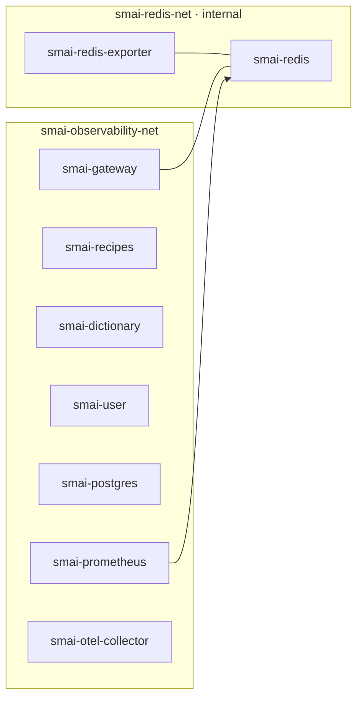

# smai-infra — инфраструктура Smart Meal AI

Репозиторий развёртывания **Smart Meal AI**: Docker Compose-стеки для ВМ, сети
между ними, workflow ручного и автоматического деплоя, а также конфигурация
наблюдаемости.

Бизнес-кода здесь нет. Репозиторий отвечает за то, чтобы образы сервисов из GHCR
были запущены с правильными переменными окружения, секретами, томами и сетями на
устройстве, доступном по NetBird.


## Состав

| Каталог | Что содержит |
|---|---|
| `services/` | Стек приложений: gateway, recipes, dictionary, user, kiosk |
| `postgres/` | PostgreSQL и pgAdmin |
| `redis/` | Redis с паролем и `redis_exporter` |
| `ai/` | Ollama на GPU, метрики Ollama, node-exporter, cAdvisor |
| `observability/` | Prometheus, Grafana, Loki, Promtail, Tempo, OTel Collector, Alertmanager |
| `.github/workflows/` | Деплой каждого стека и приём stage-событий из сервисных репозиториев |

## Сети и тома



- `smai-observability-net` — общая bridge-сеть; её создаёт стек
  `observability`, остальные стеки подключаются к ней как к внешней. Поэтому
  `observability` разворачивается первым (или сеть создаётся вручную
  `docker network create smai-observability-net`).
- `smai-redis-net` — внутренняя сеть (`internal: true`), её создаёт стек `redis`.
  Redis не публикует порт: снаружи он доступен только gateway и экспортёру.
- Именованные тома: `smai-postgres-data`, `smai-redis-data`,
  `smai-ollama-models`, `smai-kiosk-apk-data` и тома наблюдаемости.

## Стеки

### services

Compose-проект `smai-services`. Каждый сервис включается профилем, поэтому
поднимается только нужный контейнер.

| Сервис | Контейнер | Порты | Сети | Особенности |
|---|---|---|---|---|
| `gateway` | `smai-gateway` | `8000:8000` | observability, redis | Секрет `jwt_private_key` |
| `recipes` | `smai-recipes` | — | observability | Ollama и PostgreSQL по внутренним адресам |
| `dictionary` | `smai-dictionary` | — | observability | — |
| `user` | `smai-user` | — | observability | — |
| `kiosk` | `smai-kiosk` | `8888:8000` | observability | Том `smai-kiosk-apk-data` |

JWT-ключ монтируется секретом из `../security/jwt-private.pem` и доступен в
контейнере только на чтение как `/run/secrets/jwt_private_key`. Файл готовит
workflow `deploy-security`: владелец `10001:10001`, права `0400`.

Образы задаются переменными `KIOSK_IMAGE`, `GATEWAY_IMAGE`, `RECIPES_IMAGE`,
`DICTIONARY_IMAGE`, `USER_IMAGE` (по умолчанию `:latest`). Секреты и адреса
сервисов лежат в `<service>.env` рядом с compose-файлом; эти файлы создаются на
ВМ и в Git не попадают.

### postgres

Compose-проект `smai-postgres`: `postgres:16` с томом и healthcheck, порт `5432`
только внутри сети (`expose`), и `pgadmin` на `5050:80`. Пароли приходят из
`.env`.

### redis

Compose-проект `smai-redis`: `redis:7.4-alpine` с `requirepass`, AOF
(`appendonly yes`), лимитом `maxmemory 256mb` и политикой `noeviction` — при
переполнении Redis начинает отклонять запись, а не вытеснять ключи отзыва
токенов. Порт `6379` не публикуется. Рядом работает `redis_exporter` (порт
`9121` внутри сети) для Prometheus.

### ai

Compose-проект `smai-ai`: `ollama/ollama:0.6.2` с `runtime: nvidia` и CUDA,
порт `11434`; `ollama-metrics` на `8080`; `node-exporter` на `9100` и `cAdvisor`
на `8081`. Требуется NVIDIA-драйвер и Container Toolkit на хосте.

### observability

Compose-проект `smai-observability` создаёт сеть и поднимает полный контур:

| Компонент | Порт | Роль |
|---|---|---|
| Prometheus | `9090` | Сбор метрик, retention 30 дней, правила из `alerts.yml` |
| Grafana | `3000` | Дашборды, datasource provisioning, вход по паролю из окружения |
| Loki + Promtail | `3100` | Сбор stdout-логов контейнеров через Docker socket |
| Tempo | `3200` | Хранение трейсов, блоки 168 ч |
| OTel Collector | `4317`, `4318` | Приём OTLP gRPC/HTTP, трейсы в Tempo, метрики в Prometheus |
| Alertmanager | `9093` | Маршрутизация алертов в Telegram |
| node-exporter, cAdvisor | `9100`, `8080` | Метрики хоста и контейнеров |

Prometheus скрейпит сам себя, node-exporter, cAdvisor, OTel Collector, Redis
exporter, gateway, recipes, dictionary, а также `sm-ai.netbird.selfhosted`
(Ollama, его node-exporter и cAdvisor) — то есть AI-стек может жить на отдельной
машине.

Grafana провижинится автоматически: datasources `prometheus`, `loki`, `tempo`,
где из логов по `trace_id` строится переход в трейс. Дашборды скачиваются
workflow'ом в `grafana/provisioning/dashboards/json` (node-exporter, cAdvisor,
Loki, алерты, Ollama, Redis) и правятся на месте: подставляются UID datasource
и заменяется фильтр контейнеров.

Правила алертов: `TargetDown` (critical, 2 минуты), `DiskSpaceLow` (< 15 %),
`MemoryHigh` (> 90 %), `CpuHigh` (> 90 %), `ContainerDown` для контейнеров
`smai-*`, отдельная группа по Ollama. Все уведомления идут в Telegram; шаблон
`alertmanager.yml.tpl` разворачивается через `envsubst` с токеном бота и chat_id.

## Деплой

Все workflow запускаются с машины GitHub Actions: устанавливают NetBird,
поднимают туннель, ждут разрешения `SSH_HOST`, копируют каталог стека через
`rsync` в `~/smai/<stack>` и выполняют `docker compose pull && up -d` по SSH.

| Workflow | Запуск | Что делает |
|---|---|---|
| `deploy-service.yml` | вручную, выбор `environment` и `service` | Копирует `services/`, логинится в GHCR на ВМ, поднимает профиль сервиса |
| `stage-service.yml` | `repository_dispatch: stage-service` | Пишет `<service>.env` из payload, обновляет `<SERVICE>_IMAGE` в `.env` |
| `deploy-postgres.yml` | вручную | Рендерит `.env`, поднимает стек, проверяет `pg_isready` |
| `deploy-redis.yml` | вручную | Рендерит `.env`, поднимает стек, проверяет отсутствие портов, TTL и `redis_up` |
| `deploy-ai.yml` | вручную (`ai`) | Поднимает AI-стек, проверяет `/api/tags` и метрики Ollama |
| `deploy-observability.yml` | вручную | Копирует стек, рендерит `.env` и Alertmanager, скачивает дашборды, перезапускает |
| `deploy-security.yml` | вручную | Проверяет, что ключ — EC P-256 без пароля, кладёт его на ВМ с правами `0400`, проверяет права |

Сервисные репозитории (`smai-api-*`, `smai-sys-apk-kiosk`) при push в `develop`
или `main` собирают образ `ghcr.io/sun1tar/smai-<service>:sha-<sha8>` и вызывают
`stage-service` с payload `{service, environment, image, env}`. Секреты окружения
передаются в payload из GitHub Secrets сервиса и записываются в
`~/smai/services/<service>.env`.

### Порядок первичного развёртывания

1. `deploy-observability` — создаёт `smai-observability-net`.
2. `deploy-postgres`, `deploy-redis`, `deploy-ai`.
3. `deploy-security` — раскладывает JWT-ключ.
4. `deploy-service` для `gateway`, `recipes`, `dictionary`, `user`, при
   необходимости `kiosk`.

## Секреты

В репозитории только шаблоны `*.env.example`; `.gitignore` исключает `*.pem`.
Реальные значения задаются как GitHub Secrets окружений `stage`, `prod`, `ai`:
`NETBIRD_CLUSTER_URL`, `NETBIRD_SETUP_KEY`, `SSH_HOST`, `SSH_USER`,
`GHCR_USER`, `GHCR_TOKEN`, `POSTGRES_*`, `PGADMIN_*`, `REDIS_PASSWORD`,
`JWT_PRIVATE_KEY`, `GRAFANA_ADMIN_PASSWORD`, `DOMAIN_GRAFANA`,
`TELEGRAM_BOT_TOKEN`, `TELEGRAM_CHAT_ID`, `KIOSK_ENV`, `INFRA_PAT`.

В `services/.env.example` перечислены только имена образов; переменные окружения
конкретного сервиса живут в его `<service>.env` на ВМ.

## Локальная проверка

Инфраструктура рассчитана на Linux-хост с Docker: `ai` требует NVIDIA GPU,
`promtail` и `cAdvisor` монтируют `/var/lib/docker` и Docker socket, а
`deploy-*` используют `rsync` и SSH. Полностью воспроизвести стек на Windows или
macOS без правки compose-файлов нельзя.

Проверить конфигурацию без запуска:

```sh
cd services && docker compose --env-file .env config
cd ../observability && docker compose config
```

## Известные ограничения

- Одна ВМ: реплик и оркестратора нет, отказ хоста останавливает весь контур.
- Большинство образов закреплено тегами `latest` (Prometheus, Grafana, Loki,
  Promtail, Alertmanager, node-exporter, cAdvisor, pgAdmin, ollama-metrics) —
  обновление может изменить поведение без изменения коммита.
- Публикация портов наблюдаемости и AI-стека идёт на все интерфейсы
  (`9090`, `3000`, `9093`, `4317/4318`, `11434`, `8080`, `9100`, `8081`, `5050`);
  ограничение доступа целиком зависит от firewall и NetBird.
- Стеки `services` не имеют `depends_on` на PostgreSQL и Redis: порядок запуска
  обеспечивает только healthcheck самих сервисов и повторные попытки.
- TLS терминируется вне репозитория; Grafana настроена на внешний домен, но
  reverse proxy в этом репозитории не описан.
- В репозитории нет автотестов и линтеров конфигурации: проверка — `docker
  compose config` и smoke-шаги в workflow.

## Связанные репозитории

- [SmartMeal-AI](https://github.com/Sun1tAr/SmartMeal-AI) — обзор продукта;
- [smai-api-gateway](https://github.com/Sun1tAr/smai-api-gateway);
- [smai-api-user](https://github.com/Sun1tAr/smai-api-user);
- [smai-api-receipes](https://github.com/Sun1tAr/smai-api-receipes);
- [smai-api-dictionary](https://github.com/Sun1tAr/smai-api-dictionary);
- [smai-sys-apk-kiosk](https://github.com/Sun1tAr/smai-sys-apk-kiosk).
